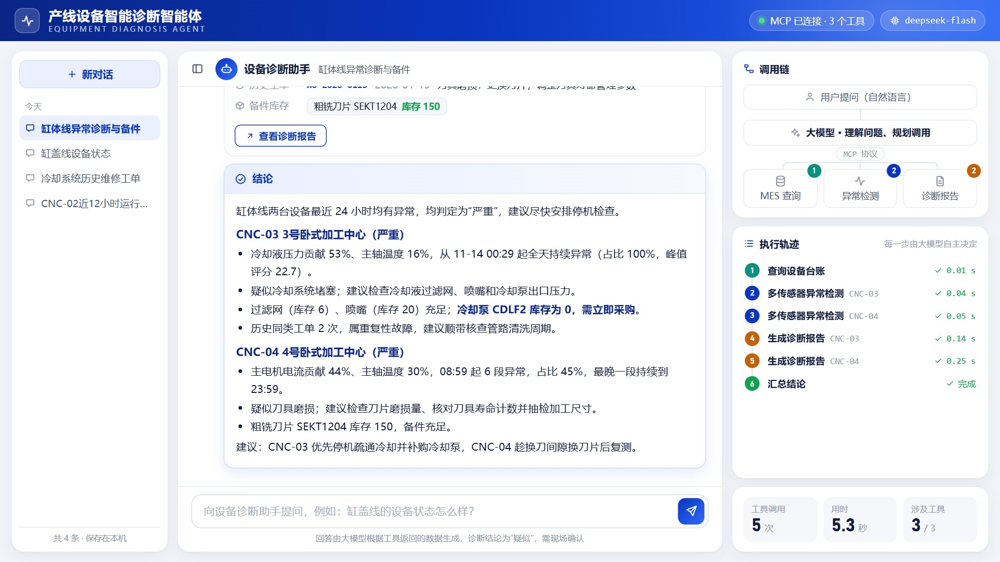
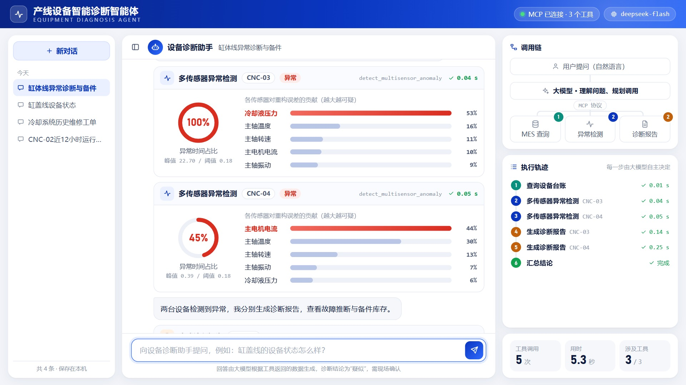
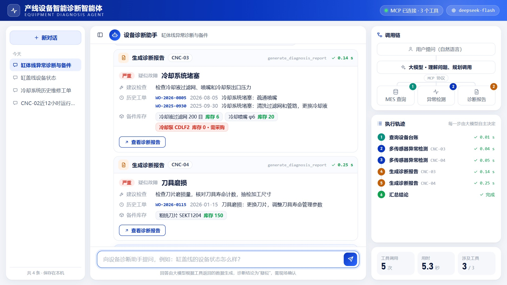
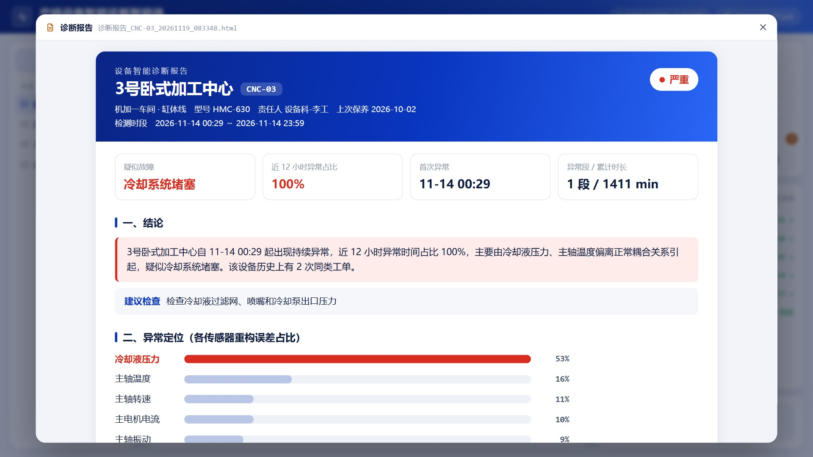
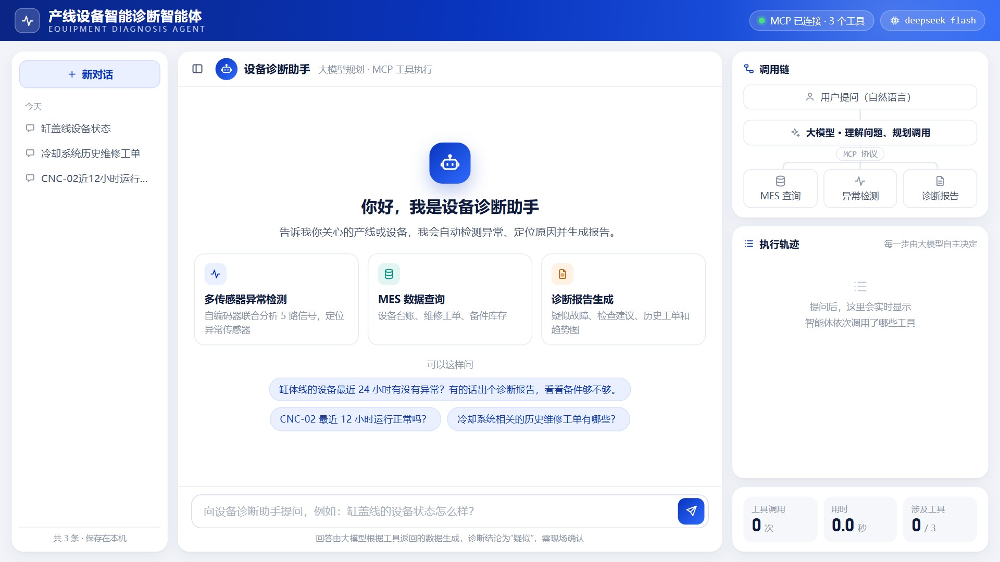
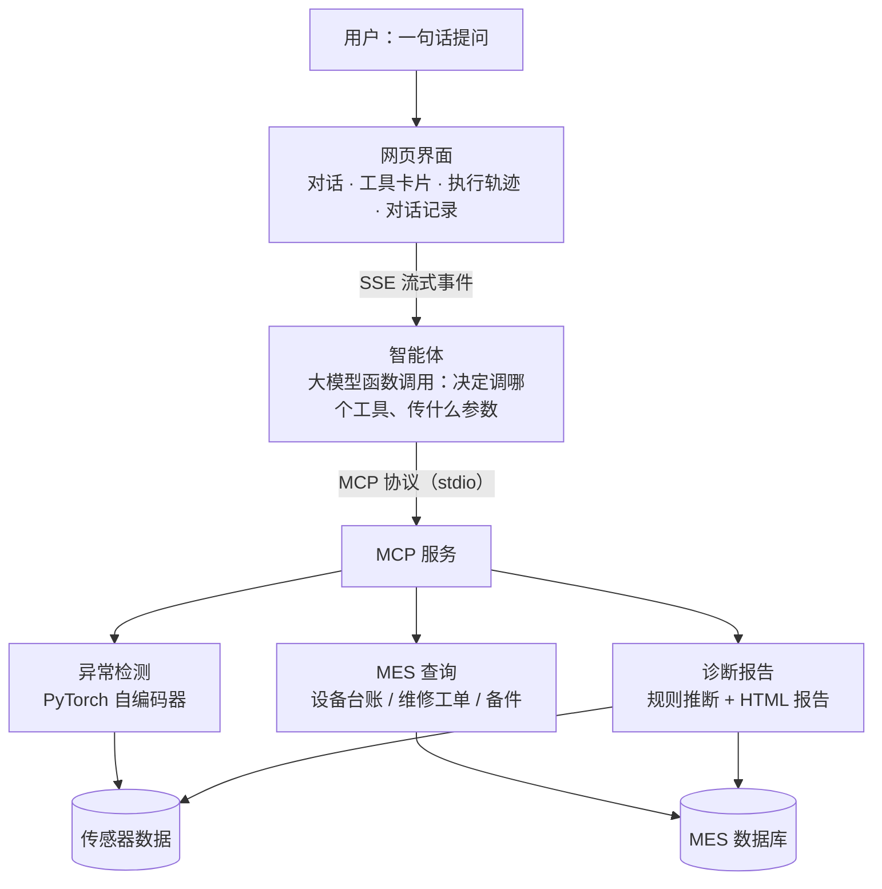

# 产线设备智能诊断智能体

用一句话提问（例如"缸体线的设备最近 24 小时有没有异常？有的话出个诊断报告，看看备件够不够"），
系统自动完成**多传感器异常检测 → 定位异常传感器 → 推断疑似故障 → 关联历史工单和备件 → 生成诊断报告**。

- **检测**：PyTorch 自编码器，对一台设备的 5 路传感器联合建模，只用正常数据训练
- **工具**：异常检测、MES 查询、诊断报告三个工具，按 [MCP](https://modelcontextprotocol.io) 标准协议封装
- **智能体**：大模型（DeepSeek）通过函数调用自己决定调哪个工具、传什么参数、何时结束
- **界面**：网页对话，实时显示每一步工具调用、执行轨迹和结论，支持对话记录

> 演示数据是**仿真生成**的，不是真实产线数据。见下面的"演示数据"和"局限"。



| 检测结果：指出哪一路传感器最可疑 | 诊断报告卡片：疑似故障、历史工单、备件 |
|---|---|
|  |  |

| 自动生成的 HTML 诊断报告 | 欢迎页与对话记录 |
|---|---|
|  |  |

## 架构



大模型只负责理解问题和规划调用，计算都在工具里完成；两者之间只通过 MCP 协议通信。
所以换数据源、换模型，都不需要改智能体本身。

## 快速开始

在 Python 3.12 上测试。

```bash
python -m venv .venv
.venv\Scripts\activate            # Linux / macOS: source .venv/bin/activate
pip install -r requirements.txt
```

1. 把 `diag_agent/.env.example` 复制为 `diag_agent/.env`，填入 DeepSeek 的 API Key。
   `.env` 已被 `.gitignore` 排除，不会进入版本库。
2. 启动：

   ```bash
   python diag_agent/app.py
   ```

   Windows 下也可以直接双击 `start.bat`。
3. 浏览器打开 <http://127.0.0.1:8770>，直接提问。

仓库里已经带了生成好的演示数据和训练好的模型，可以直接运行。想重新生成：

```bash
python -m diag_tools.demo_data    # 重新生成传感器数据和模拟 MES 数据库
python -m diag_tools.anomaly      # 重新训练自编码器（CPU 上约 10 秒）
```

不想开网页，也可以在命令行里跑一轮：`python diag_agent/run_cli.py "CNC-02 最近 12 小时运行正常吗？"`

## 三个 MCP 工具

| 工具 | 做什么 | 实现要点 |
|---|---|---|
| `detect_multisensor_anomaly` | 判断一台设备 5 路传感器之间的配合关系是否偏离正常，并指出偏离最大的传感器 | 30 分钟滑动窗口 × 5 路信号 = 150 维；全连接自编码器 150→64→16→64→150；重构误差作为异常分数 |
| `query_equipment_records` | 查设备台账、维修工单、备件库存 | SQLite 模拟 MES；只读连接；SQL 全部参数化，不接受模型拼出来的 SQL |
| `generate_diagnosis_report` | 把检测结果、疑似故障、同类历史工单、备件库存合成 HTML 报告 | 按各传感器的误差占比查规则表，推断疑似故障；Plotly 趋势图（本地脚本，离线可看） |

MCP 服务也可以单独启动，供其他支持 MCP 的平台接入：

```bash
python -m diag_tools.server --transport streamable-http --port 8765
```

## 异常检测的做法

检测的不是某个数值有没有超限，而是 5 路信号之间的关系有没有被破坏。
正常时负载一上来，转速、电流、温度会配套变化；故障时这种配套关系会被打破，
而每个数值单看可能都还在正常范围内。

1. **训练**：只用正常工况的数据，让自编码器学会还原 30 分钟窗口内的 5 路信号。
2. **打分**：新数据还原得越差（重构误差越大），越不正常。
3. **阈值**：取正常验证集重构误差的 99.5% 分位数。
4. **告警**：连续超过阈值 10 分钟以上才算一段异常，避免单点误报。
5. **定位**：比较各传感器的重构误差（先除以各自在正常数据上的基线），占比最大的就是最可疑的。
6. **推断故障**：按"哪几路传感器占主导"查规则表，例如"振动 + 温度"对应主轴轴承磨损。
   这一步是规则推断，结论是"疑似"，需要现场确认。

## 演示数据

`diag_tools/demo_data.py` 生成 4 台数控加工中心 5 天的数据，每分钟一个点，
5 路传感器按物理关系耦合（负载决定转速和电流，转速影响振动，温度是负载的一阶滞后，冷却液压力随负载略降）。
从第 3.5 天起注入渐进故障：

| 设备 | 注入的故障 | 表现 | 检测结果 |
|---|---|---|---|
| CNC-01 | 无（对照） | 正常 | 没有告警 |
| CNC-02 | 主轴轴承磨损 | 振动、温度升高 | 检出，定位到主轴振动 |
| CNC-03 | 冷却管路堵塞 | 冷却液压力下降、温度升高 | 检出，定位到冷却液压力 |
| CNC-04 | 刀具磨损 | 电流升高、振动略增 | 检出，定位到主电机电流 |

## 测试

```bash
python -m pytest diag_tools/tests -q
```

覆盖：正常设备不告警、三类故障能检出并定位、时间窗口、非法参数、MES 查询的过滤与排序、
SQL 注入和只读保护、诊断报告的故障推断与历史工单关联、MCP 工具注册。

## 换成真实数据要改哪里

| 改哪里 | 现在 | 换成 |
|---|---|---|
| 传感器清单（`diag_tools/__init__.py`） | 5 路仿真信号 | 设备实际有的测点（几路都可以，模型输入会跟着变） |
| 读数据（`anomaly.py` 的 `load_sensor_data`） | 读本地 CSV | 从数采系统或时序数据库取最近几小时的数据 |
| 训练时间段（`anomaly.py` 的 `train`） | 前 2.5 天训练、后 1 天定阈值 | 一段确认正常的历史数据，最好覆盖各种工况 |
| MES 查询（`mes_db.py`） | 本地 SQLite | 企业 MES、设备管理系统的只读接口 |
| 故障规则表（`diagnosis.py` 的 `RULES`） | 三类仿真故障 | 结合设备的故障经验和历史工单重写 |
| 大模型地址（`diag_agent/.env`） | DeepSeek 公网服务 | 任何兼容 OpenAI 接口的模型服务，包括私有化部署 |

工具的接口、智能体和界面不用改。

## 目录结构

```
diag_tools/            三个 MCP 工具
  anomaly.py           自编码器训练、打分、异常段提取
  mes_db.py            MES 只读查询
  diagnosis.py         故障推断规则、HTML 报告
  tools.py             MCP 工具定义
  server.py            MCP 服务入口
  demo_data.py         仿真数据和模拟 MES 的生成脚本
  data/  models/       生成好的演示数据、训练好的模型
  tests/               测试
diag_agent/            智能体和网页
  agent_core.py        大模型函数调用循环 + MCP 客户端
  app.py               网页服务（Starlette，SSE 流式）
  conv_store.py        对话记录的本地存储
  static/index.html    界面
scripts/               录制演示视频、合成解说的脚本
```

## 局限

- 数据是仿真的。真实产线的工况更复杂（不同产品、不同加工程序、传感器漂移），需要分工况或分机型训练，并用历史工单回测来调阈值。
- 故障类型来自规则表，不是模型学出来的。
- 4 台设备共用一个模型；真实场景应按机型分别训练。
- 智能体每次只带最近几轮的问题和结论作为上下文，不带工具的原始返回。

## 致谢

- MCP 工具的组织方式（模块级函数 + 统一注册、在注册处把可预期的错误转成工具错误）参考了开源项目
  [predictive-maintenance-mcp](https://github.com/LGDiMaggio/predictive-maintenance-mcp)（MIT 许可）。
- 协议：[Model Context Protocol](https://modelcontextprotocol.io) Python SDK。

## 许可

[MIT](LICENSE)
